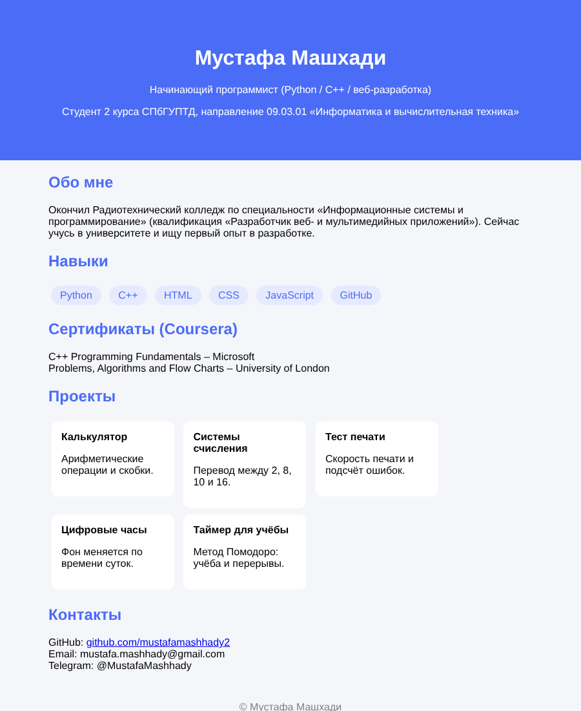

# Личная страница

Сайт-визитка: коротко обо мне, мои навыки и ссылки на остальные проекты.

Демо: https://mustafamashhady2.github.io/about-me/

## Задача
Нужна была одна страница, которую можно указать в резюме, чтобы работодатель сразу видел все проекты.

## Что сделано
Страница свёрстана на HTML и оформлена через CSS. Есть шапка, блок «Обо мне», навыки и карточки со ссылками на проекты. Сайт опубликован через GitHub Pages.

## Инструменты
HTML, CSS, GitHub Pages

## Контекст
Учебный проект, делал один.
